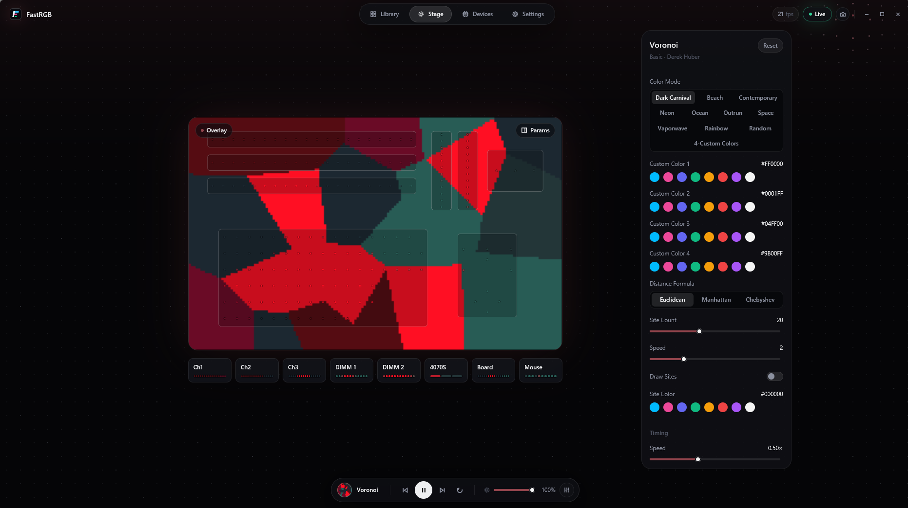
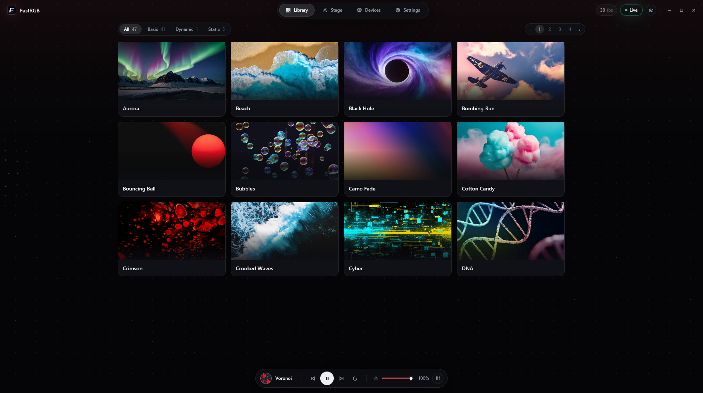
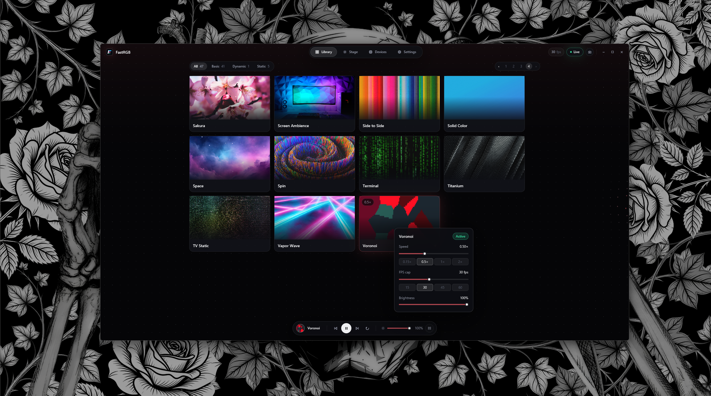
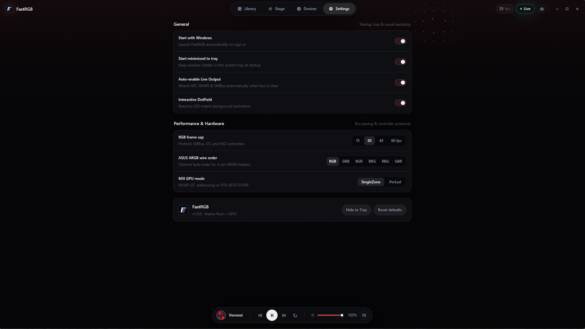

<p align="center">
  
</p>

<h1 align="center">FastRGB</h1>

<p align="center">
  Minimalist, native Rust + GPUI RGB controller built for low latency and zero gaming overhead.
</p>

---

## Preview

### Stage & Live Canvas


### Effect Library


### Quick Tune Popover


### Settings


---

## Highlights

- **100% Native Rust + GPUI** — No Electron, no embedded browser, ~5 MB Windows installer.
- **Zero GPU Idle in Tray** — Closing (`×`) minimizes to the Windows System Tray, releasing GPU textures while keeping physical LEDs alive on a lightweight CPU worker.
- **47 Built-in Effects** — Procedural shaders + real-time DXGI **Screen Ambience** (auto-stops capture when switching to non-screen effects).
- **Direct Hardware Drivers** — ASUS Aura USB HID (`0x0B05:0x19AF`), MSI RTX 40-series NVAPI I2C, and Corsair Dominator Platinum SMBus (`DIMM 1` & `DIMM 2`, `12×2` independent modules).
- **Bus-Safe Pacing** — Hard `60 FPS` RGB ceiling (selectable `15 / 30 / 45 / 60 fps`) to protect SMBus/I2C and keep gaming 1% lows clean.
- **Windows Integration** — Custom frameless titlebar, native System Tray menu, `Start with Windows` (`HKCU\...\Run`), and persistent `%APPDATA%\FastRGB\settings.json`.

---

## Build & Run

```powershell
# Run in development mode
cargo run -p fastrgb-app

# Run workspace checks & tests
cargo fmt --all -- --check
cargo clippy --workspace --all-targets -- -D warnings
cargo test --workspace
```

## Build Windows Installer (`.msi`)

Requires [WiX Toolset v5](https://wixtoolset.org/):

```powershell
pwsh -NoProfile -ExecutionPolicy Bypass -File installer\build-installer.ps1
```
